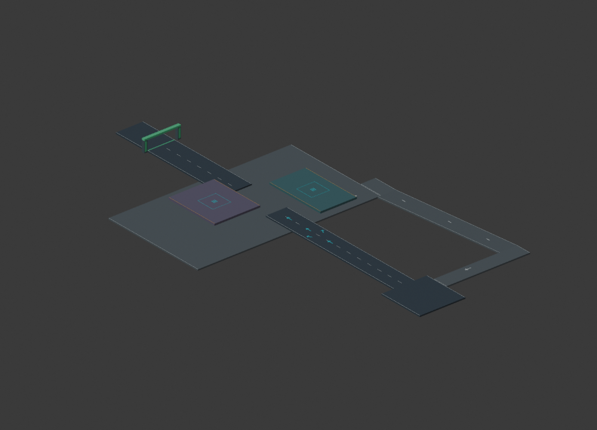

# Roadster 原型场地构建

场地由主控通过Blender MCP在Blender 5.2.2 LTS中构建。独立场景为 `Roadster_Core_Lab_v1`，原有其他项目文件未覆盖。道路、平台、回程坡道、补气标记和出口均已导出到游戏使用的GLB。

| 文件 | 用途 |
| --- | --- |
| `assets/blender/roadster-lab.blend` | 只包含本场地及依赖的Blender源文件 |
| `assets/blender/build_roadster_lab.py` | 通过Blender MCP执行的场地构建脚本 |
| `assets/blender/roadster-lab-overview.png` | Blender Workbench相机预览 |
| `public/assets/roadster-lab.glb` | 游戏实际加载的场地，76个网格 |
| `public/assets/roadster-lab-layout.json` | 同源道路顶面、坡度、补气区、出口与恢复点数据 |
| `docs/roadster-blender-validation.json` | 导出网格与布局边界核对结果 |

世界坐标为x左右、y高度、z前进。Blender采用 `(x,-z,y)` 放置，导出glTF后得到游戏坐标。Babylon采用左手系，并将glTF额外导入根节点的转换归为单位变换，保持看向+z时+x在屏幕右方。视觉、碰撞和输入使用同一组坐标。首轮右手系方案曾导致左右颠倒，已通过实际D键右转和平台位置检查修正。

9个道路或平台顶面与设计对应。斜坡顶面高度为 `top + slope * (z - origin_z)`。主路断口为z=130至160；左平台高4米，右平台高10米；下层道路高-8米，左侧回程坡道回到起点。

首轮主控实玩暴露平台纵向容错偏窄，已通过Blender MCP把低平台扩到z=110至150（24×40米），高平台扩到z=126至162（30×36米），保持高度、横向位置与补气中区。GLB、布局、Blender源和预览同步更新。

主控直接解析导出GLB的二进制POSITION顶点，9个实体的x/z边界与上下边界均匹配布局数据。检查脚本为 `scripts/audit-roadster-blender.mjs`。导出网格已统一朝外法线；独立Blender预览检查了断口、平台高度和回路连接。回程平路在z=25处与坡道无落差拼接。实际加载、碰撞与可驾驶性仍需游戏试玩验收。

Blender插件首次握手和EEVEE画面捕获曾断开连接。建模和GLB导出已成功，最终采用Blender MCP调用Workbench渲染并读取本地图片完成视觉检查，没有以其他建模工具替代场景构建。

